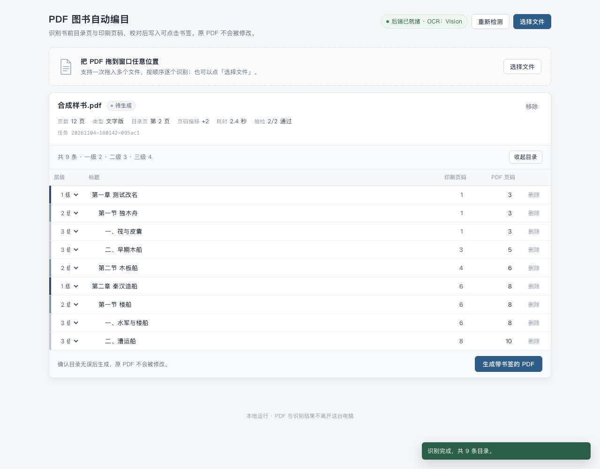

# pdf-bookmark · PDF 图书自动编目

给下载来的 PDF 版图书（尤其是扫描版）自动生成**可跳转的书签目录**：识别书前目录页
→ 读出每个条目的标题和印刷页码 → 换算成 PDF 实际页码 → 写进书签（Outlines）。

## 它解决的三件事

1. **目录识别**：在书前若干页里找到"目录/目次"，解析出条目、层级（章/节/一、（一））和页码。
2. **页码对齐**（最麻烦的一步）：书里的"第 356 页"不是 PDF 的第 356 页——封面、版权页、
   前言、目录各有一套页码，正文页码又从 1 重新开始。程序把每页页脚的印刷页码读出来，
   用"物理页 − 印刷页码"的众数找出正文段，自动算出偏移量（本示例书为 +23）。
3. **写入书签**：按层级写进 PDF 大纲，并回读校验、抽章比对。

## 环境

- macOS（OCR 用系统自带 Vision 框架，中文识别质量好、不用下载模型、不用联网）
- Python 3.9+，`PyMuPDF`（`import fitz`）
- 首次使用需编译 OCR 小工具：

```bash
swiftc -O -o bin/visionocr tools/visionocr.swift -framework Vision -framework AppKit
```

没有 Vision 时会退回 `tesseract`（需装 `chi_sim` 语言包）。

## 用法

```bash
# 体检：页数、有没有文字层、有没有已存在的书签
python3 -m pdfbookmark inspect 某书.pdf

# 全流程
python3 -m pdfbookmark run 某书.pdf -o ./out -j 8

# 已经有书签的书，强制重建
python3 -m pdfbookmark run 某书.pdf --force

# 批量：把一个文件夹里的书全部跑一遍，出汇总表
python3 -m pdfbookmark batch ~/Desktop/大创 -o ./out/批量

# 图形界面（也可以直接双击「启动界面.command」）
python3 -m pdfbookmark gui

# 手工改过目录 JSON 之后重新写入
python3 -m pdfbookmark apply 某书.pdf ./out/某书.toc.json -o 某书.bookmarked.pdf
```

## 产出（都在 `-o` 目录里）

| 文件 | 说明 |
| --- | --- |
| `某书.bookmarked.pdf` | 带书签的新文件，原文件不动 |
| `某书.toc.json` | 识别结果，可手工改标题/页码后 `apply` |
| `某书.report.md` | 报告：目录页位置、偏移量、抽章比对结果 |

## 几个实现上的坑（踩过的）

- **整页 OCR 会漏掉目录右栏的页码**：引导点连成一长串时，Vision 把整行判成装饰。
  必须单独识别右栏。
- **右栏也不能整条竖切**：宽高比约 0.3 的窄长条，Vision 几乎什么都识别不出。要切成
  上下两个横带，再把坐标换算回整页。
- **不同分辨率能捞到的数字不一样**：200dpi 能认出 300dpi 漏掉的那些页码，所以跨尺度
  合并，按纵坐标去重。
- **页码 OCR 会错**（如 4 读成 7）：所以不逐页硬对齐，而是用偏移量众数 + 离群点剔除。
- **目录标题换行**：带页码的那行常常是标题的第二行，要拼回去（但只拼没有编号的碎片）。

## 图形界面

`python3 -m pdfbookmark gui`（或双击 `启动界面.command`）会起一个本地网页，默认
http://127.0.0.1:8765，把 PDF 从访达直接拖进页面即可。识别完会列出可编辑的目录
表格：改标题、调层级、删掉识别错的条目，点「生成带书签的 PDF」。

浏览器可能会拦截网页发起的自动下载（Safari 尤其如此），所以生成成功后卡片上会
**直接显示文件的绝对路径**，还有一颗「**在访达中显示**」按钮——点一下就在访达里
定位到那个 PDF，不依赖浏览器下载。整个过程只在本机，文件不上传外网。



## 批量

`batch` 会把文件夹里所有 PDF 排队跑一遍，已有的书签默认跳过（`--force` 重建），
单本失败不影响整批。最后出 `批量报告.md` 和 `批量报告.csv`，每本记状态、页数、
目录页位置、偏移量、书签数、抽查通过率和失败原因。

## 自测

仓库里带了一本 38KB 的合成样书（12 页，目录 + 正文页码两套编号），不依赖外部文件：

```bash
python3 tests/make_sample.py testdata/合成样书.pdf
python3 -m pdfbookmark run testdata/合成样书.pdf -o ./out --force
```

预期：9 条书签、偏移 +2、抽查 2/2。

## 已知限制

- 前置页（摘要、目录等用罗马页码 i/ii/iii）的条目会被跳过，因为和正文偏移不是一套。
- 双栏排版的中文目录还没专门处理（单栏效果最好）。
- 扫描件处理速度约 1 页/0.15 秒（8 线程），668 页的书约 25–100 秒。
- 没有目录页、或目录完全靠图片的，需要之后加"按版式猜标题"的兜底。

## 已验证

| 书 | 类型 | 页数 | 结果 |
| --- | --- | --- | --- |
| 中国造船通史（席龙飞） | 扫描件、无文字层、无书签 | 668 | 312 条书签，13 章全部对齐，抽 8 章 8 中 |
| 秦汉时期岭南地区饮食文化研究（李炎焜） | 文字版、已有 24 条书签 | 75 | 21 条书签，抽 8 章 7 中 |
